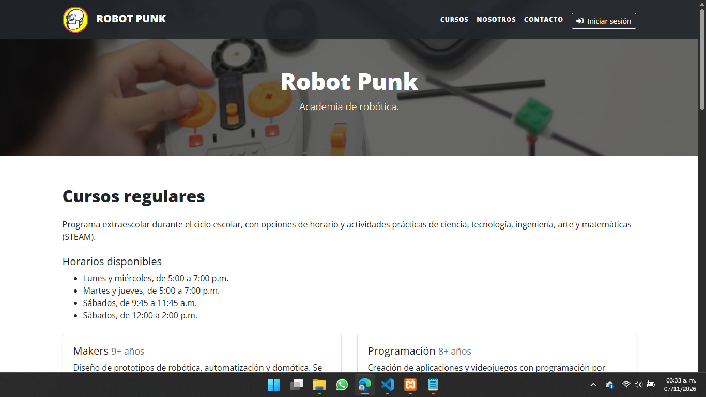
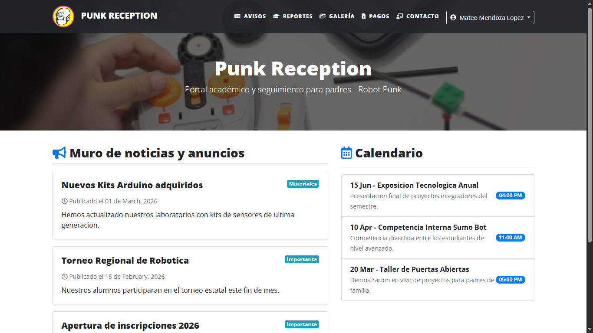
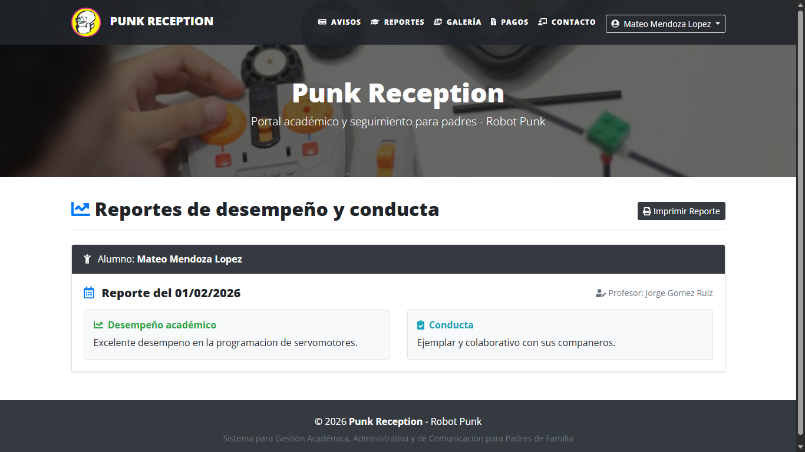
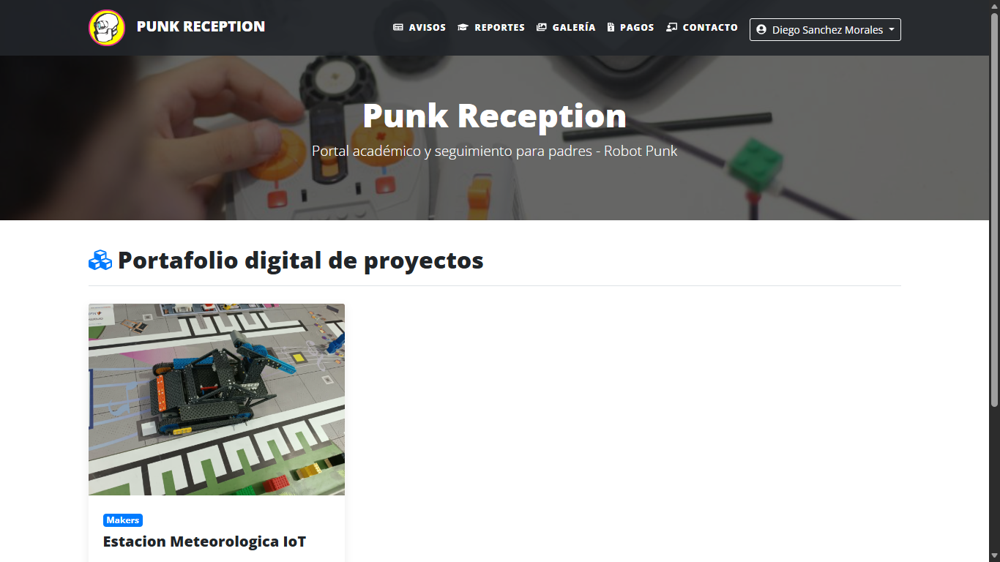

<h2><b>PUNK RECEPTION</b></h2>

<h3>Integrantes:</h3>

- Sergio Jaciel Jiménez González

- Alejandro Lozano Avila

<h2>Proyecto de la unidad 3</h2>

<h3>Tablas involucradas:</h3>
<ul>
  <li>Noticia</li>
  <li>Evento</li>
  <li>Reporte</li>
  <li>Galeria</li>
</ul>

<h3>Datos para iniciar sesion:</h3>
<ul>
  <li>Correo: <u>carlos.mendoza@email.com</u></li>
  <li>Contraseña: <u>1234</u></li>
</ul>
 

<h3>Pantalla de inicio:</h3>

Para esta unidad agregamos otra página de inicio que contiene información sobre el sitio web o empresa en la que se basa el sistema, esto para simular un pequeño login. 

 

<h3>Pantalla de avisos y noticias:</h3>

Tablas: Noticia y Evento. Estas simulan la sincronización de un panel de avisos para padres y/o tutores. 

 

<h3>Pantalla de reportes:</h3>

Tabla: Reporte. Esta simula la sincronización de un panel de reportes de conducta de los alumnos para padres y/o tutores. 

 

<h3>Pantalla de galeria:</h3>

Tabla: Proyecto. Esta simula la sincronización de una galería de proyectos realizados por los alumnos para padres y/o tutores. 

 
